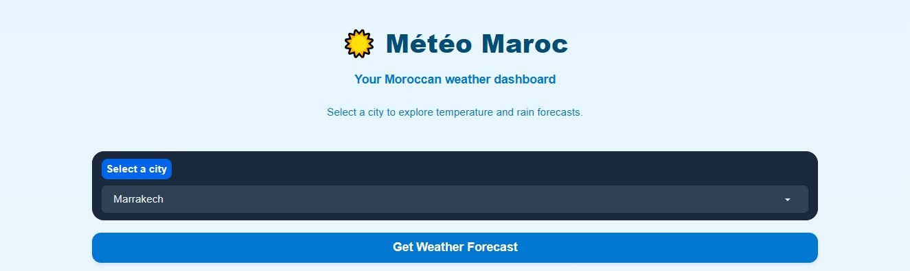
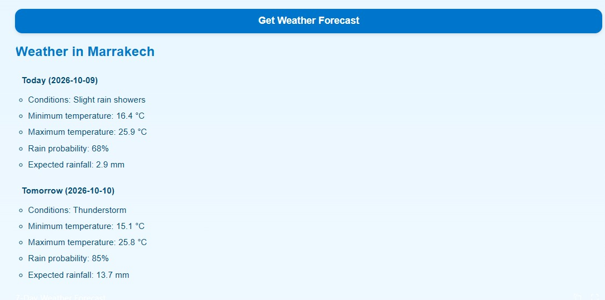
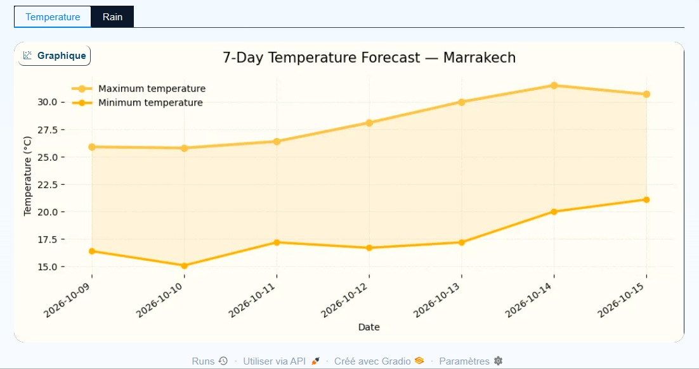
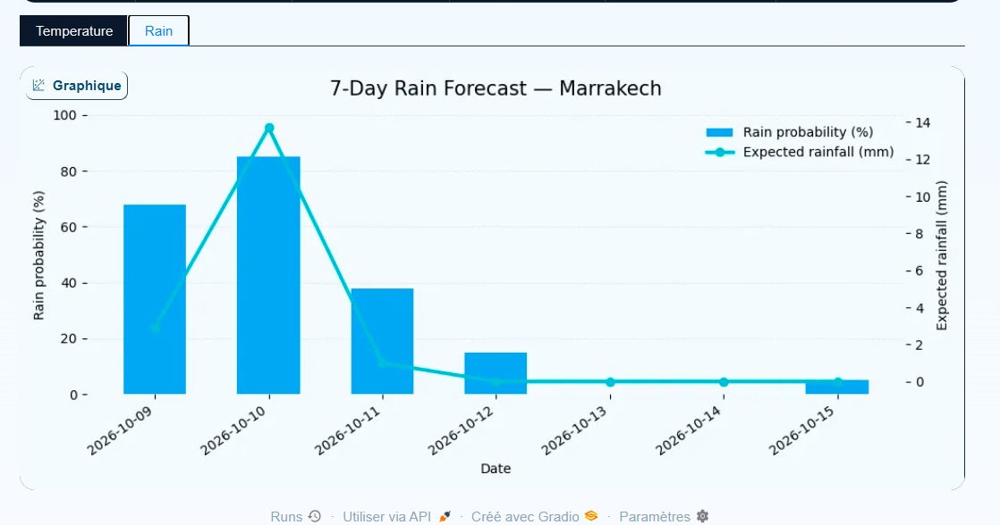
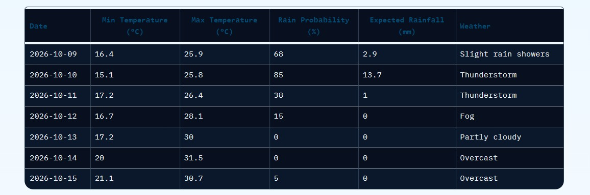

# 🌤️ Météo Maroc — Morocco Weather Dashboard

**Created by Salma Majri**

An interactive weather dashboard built with Python in Google Colab to explore weather forecasts for cities across Morocco. The project presents daily weather information, temperature forecasts, rain probability, and expected rainfall through visualizations and a clean blue-and-white interface.

##  Screenshots

### 1.  Dashboard Homepage

The main interface, featuring the city selector and weather forecast button.



### 2. 🌦️ Daily Weather Forecast

Displays today's and tomorrow's weather conditions, minimum and maximum temperatures, rain probability, and expected rainfall.



### 3. 🌡️ 7-Day Temperature Forecast

Visualizes minimum and maximum temperatures over the next seven days.



### 4. 🌧️ 7-Day Rain Forecast

Shows rain probability and expected rainfall using a combination of bars and a line chart.



### 5.  Complete Dashboard View

An additional view of the weather dashboard and its blue-and-white interface.



##  Features

- 🇲🇦 Weather forecasts for selected Moroccan cities.
- 🌡️ Daily minimum and maximum temperatures.
- 🌧️ Rain probability and expected rainfall.
- 📅 Daily and 7-day weather forecasts.
- 📊 Temperature and rainfall visualizations.
- 🎨 Blue-and-white user interface.
- 🖥️ Interactive web interface powered by Gradio.

##  Technologies Used

- **Python** — programming and application logic.
- **Google Colab** — notebook development and execution.
- **Gradio** — interactive web interface.
- **Open-Meteo API** — weather forecast data.
- **Pandas** — data manipulation and processing.
- **Matplotlib** — weather data visualization.
- **Requests** — API requests.

##  How to Run the Project

This project is developed in a Google Colab notebook (`.ipynb`).

### Step 1: Open the notebook

Download the notebook from this repository and upload it to [Google Colab](https://colab.research.google.com/), or open it directly from GitHub using Google Colab.

### Step 2: Install the required libraries

Run the installation cell in the notebook. If needed, install the dependencies with:

```python
!pip install gradio pandas matplotlib requests
```

### Step 3: Run the notebook

Execute the notebook cells in order, from the first cell to the last.

The notebook retrieves weather data, processes it, creates the charts, and launches the Gradio interface.

### Step 4: Explore the dashboard

Select a Moroccan city and click **Get Weather Forecast** to explore the available forecast information and charts.

## 🌍 Weather Data Source

Weather forecast data is provided by the [Open-Meteo API](https://open-meteo.com/).

##  Project Objectives

- Practice Python programming and data analysis.
- Learn how to retrieve data from a weather API.
- Visualize weather information using charts.
- Build an interactive dashboard with Gradio.
- Develop a foundation for future machine learning applications.

##  Future Improvements

- Integrate machine learning models for weather prediction.
- Add more Moroccan cities.
- Improve the interface with weather icons and forecast cards.
- Add more weather visualizations.
- Explore additional weather variables and trends.

##  Author

**Salma Majri**

---

⭐ Thank you for checking out Météo Maroc!
